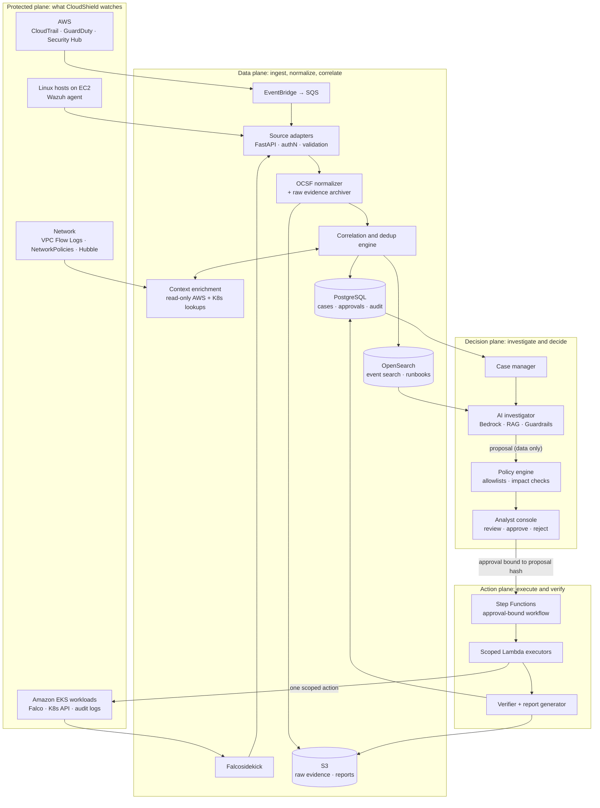
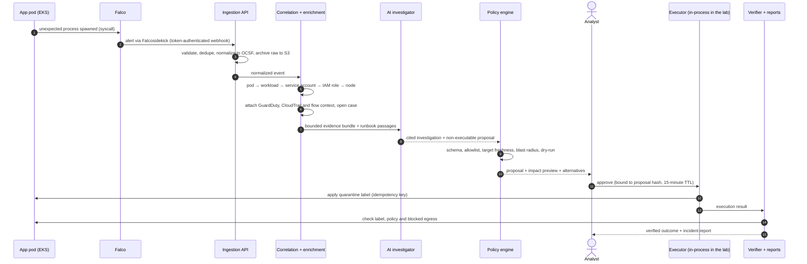

<div align="center">

# CloudShield

### AI-assisted, cloud-native security operations with human-controlled incident response

**Detect → Correlate → Investigate → Respond**, across AWS, Linux, Kubernetes and the network,<br/>
with grounded AI investigations and response actions that cannot bypass policy or people.


[](https://github.com/aymen-nasri/cloudshield/actions/workflows/ci.yml)


</div>

---

> **The core rule of CloudShield**
>
> **AI suggests → independent policy authorizes → a named human approves → deterministic code executes → evidence verifies.**
>
> The language model never holds write credentials, and no text an attacker can plant in a log can turn into an infrastructure change.

---

## At a glance

| | |
|---|---|
| **What it does** | Turns AWS, Kubernetes and Linux security alerts into one evidence-backed case, then lets a containment action run only after a policy check and a named human approval, verifies the result, and writes the post-incident report ([sample](docs/sample-incident-report.md)) |
| **Built with** | Python · FastAPI · Pydantic · PostgreSQL · OCSF · Kyverno · GitHub Actions, with OpenTofu and Helm validated in CI |
| **Works with** | Falco, GuardDuty and Wazuh alert formats · the Kubernetes API (tested against a simulated API) · Amazon Bedrock (client written, not yet run) |
| **Evidence it works** | 160+ automated tests in CI (including PostgreSQL and policy-bypass tests), infrastructure validated in CI with OpenTofu, Helm, kubeconform and Kyverno, and the replayable demo below |
| **Status** | The detect → case → investigate → approve → contain → verify → report loop works in code and in CI. It has **not yet run on a real cluster, an AWS account or Bedrock** (see [Roadmap](#roadmap)) |

**Reading this README:** it describes the target design and marks what exists: ✅ **built**, implemented and tested here · 🧩 **as code**, written (OpenTofu, Helm, Step Functions definition, CI job) but never deployed · 📐 **designed**, documented only.

### See it run

`python scripts/demo.py` replays scenario S1 through the real API: CloudShield's ingestion, enrichment, correlation, policy gate, approvals, execution and audit code all run for real; only the Kubernetes API and AWS lookups are simulated.

<p align="center"></p>

**The analyst console** (`python scripts/console_demo.py`, then open http://127.0.0.1:8090/console) is the incident page from the design, served by the API. Here a quarantine is waiting for approval: the facts cite their events, the affected pod is traced to its IAM role and EC2 instance, and the impact preview shows what the pod will lose.

<p align="center"></p>

### Where to look, by role

| If you're hiring for… | Read | Then open |
|---|---|---|
| **Cloud security engineer** | [AWS layer](docs/technology-stack.md#aws-cloud-layer), and scenario S2: a pod's stolen IAM credentials joined to its runtime alert | [`enrichment/`](services/enrichment), [`guardduty.py`](services/ingestion/adapters/guardduty.py), [`infra/tofu/envs/lab/`](infra/tofu/envs/lab) |
| **DevSecOps / platform security** | [DevSecOps pipeline](docs/security.md#devops-and-devsecops-pipeline), [ADR 0002](docs/adr/0002-quarantine-via-label.md) | [`ci.yml`](.github/workflows/ci.yml), [`infra/policies/`](infra/policies), [Kyverno test](infra/policies/kyverno/tests/require-quarantine-exclusion/kyverno-test.yaml) |
| **Detection engineer** | [Correlation rules](docs/data-pipeline.md#correlation-rules), [attack scenarios](#incident-scenarios-and-mitre-attck-mapping) | [`cloudshield_rules.yaml`](detections/falco/cloudshield_rules.yaml), [`adapters/`](services/ingestion/adapters), [`test_scenarios.py`](tests/test_scenarios.py) |
| **SOC analyst / incident responder** | [The analyst incident page](docs/response.md#the-analyst-incident-page), [sample incident report](docs/sample-incident-report.md) | [`runbooks/`](runbooks), [`detections/fixtures/`](detections/fixtures), the console above |
| **Security automation / SOAR** | [Human-approved response](docs/response.md#human-approved-response) | [`response/service.py`](services/response/service.py), [`policy/engine.py`](services/policy/engine.py), [`actions.yaml`](services/policy/policies/actions.yaml), [`test_response_flow.py`](tests/test_response_flow.py) |
| **AI security / LLM engineering** | [AI investigation layer](docs/ai-investigation.md#ai-investigation-layer), [ADR 0003](docs/adr/0003-llm-closed-action-vocabulary.md) | [`validate.py`](services/investigator/validate.py), [`bundle.py`](services/investigator/bundle.py), [`evals/`](evals) |
| **Audit and evidence integrity** | [Threat model](docs/security.md#threat-model-and-ai-safety), [evaluation](docs/evaluation.md#evaluation-kpis-and-test-catalog) | [`audit.py`](services/cases/audit.py) (hash-chained audit log), [`report.py`](services/reporting/report.py), [`evidence.py`](services/ingestion/evidence.py) |
| **Backend / software engineer** | [Data model](docs/data-pipeline.md#data-model), [API surface](docs/response.md#api-surface) | [`core/`](services/core), [`postgres.py`](services/storage/postgres.py), [`migrations/`](services/cases/migrations) |

---

## Table of contents

1. [What CloudShield is](#what-cloudshield-is)
2. [Skills this project demonstrates](#skills-this-project-demonstrates)
3. [Architecture](#architecture)
4. [End-to-end incident flow](#end-to-end-incident-flow)
5. [Incident scenarios and MITRE ATT&CK mapping](#incident-scenarios-and-mitre-attck-mapping)
6. [Roadmap](#roadmap)
7. [Documentation](#documentation): the deep dives
8. [Repository layout](#repository-layout)
9. [Getting started](#getting-started)
10. [How this was built](#how-this-was-built)
11. [Author and license](#author-and-license)

---

## What CloudShield is

CloudShield is a unified, AI-assisted security operations platform for teams running on **AWS and Kubernetes**. It connects AWS cloud findings, Linux host activity, Kubernetes workload behavior and network telemetry into **one evidence-backed incident case**. It then helps an analyst understand what happened, choose a safe response and prove the outcome.

It works in four stages:

| Stage | What CloudShield does | What it produces |
|---|---|---|
| **SEE** | Receives security signals from cloud, hosts, clusters and networks | Structured alerts, each linked to its raw source record |
| **UNDERSTAND** | Correlates related events and enriches them with asset, identity and service context | An evidence-backed incident case |
| **RESPOND** | Proposes containment, previews consequences, gets approval and performs only authorized steps | A verified action record |
| **LEARN** | Generates timelines, post-incident reports and proposed rule and runbook improvements | Reusable investigation knowledge |

### What makes it different

CloudShield does **not** reinvent detection, a SIEM, or AWS's own AI investigations (GuardDuty announced AI-powered investigations in preview in June 2026 [[R1]](docs/references.md#references)). It adds the three things those tools leave open:

1. **Cross-layer context.** One case links the AWS identity, the EC2 node, the Kubernetes pod, its service account and the network paths it uses.
2. **Explainable investigations with provenance.** Every factual claim the AI makes cites the exact event IDs behind it. Facts, hypotheses and unknowns are kept apart.
3. **Response safety.** A deterministic policy gate, impact preview, named approval, idempotent execution and post-action verification stop an automated mistake from becoming an outage.

### Scope

| In scope | Explicitly out of scope |
|---|---|
| Monitoring integrations, case assembly, read-only enrichment | Replacing GuardDuty, Wazuh, Falco or the AWS security stack |
| Analyst dashboard and LLM-assisted explanation | Running as a managed SOC service |
| Policy- and approval-gated response with verification | Irreversible actions (deleting resources, destroying keys, erasing data) |
| Reports, audit trail and a secure CI/CD pipeline | Any execution path from the LLM to production |

**Guiding principle:** prove one complete incident workflow end to end before adding more infrastructure or tools.

---

## Skills this project demonstrates

| Domain | What CloudShield exercises |
|---|---|
| **AWS** | ✅ GuardDuty findings, EKS Pod Identity and EC2 lookups, S3 evidence store, SQS consumer · 🧩 VPC, EKS, IAM, EventBridge, S3 Object Lock, budgets, GitHub OIDC (OpenTofu), Step Functions + Lambda (definition and handler), Bedrock client · 📐 CloudTrail, Security Hub, Secrets Manager |
| **Linux** | ✅ Wazuh alert ingestion and the host-compromise scenario · 🧩 host hardening and Wazuh enrolment with Ansible |
| **Kubernetes** | ✅ workload metadata, NetworkPolicy quarantine and its verification, Kyverno policy tests · 🧩 RBAC, Helm chart, demo app |
| **Networking** | ✅ pod-to-pod policy and egress control in the quarantine · 🧩 VPC Flow Logs enabled in OpenTofu · 📐 Security Group isolation, eBPF visibility (Cilium/Hubble) |
| **Detection engineering** | ✅ custom Falco rules, five replayable attack scenarios tested in CI, MITRE ATT&CK tagging |
| **Data engineering** | ✅ OCSF normalization, idempotent ingestion, PostgreSQL modeling and migrations · 🧩 dead-letter queue · 📐 OpenSearch indexing |
| **AI engineering** | ✅ runbook retrieval, structured outputs, citation enforcement, prompt-injection defenses, evaluation harness · 🧩 Bedrock client · 📐 vector search, LangGraph, MCP |
| **Software engineering** | ✅ FastAPI services, Pydantic contracts, state machines, hash-chained audit log, REST API and console |
| **DevOps** | ✅ GitHub Actions, Docker · 🧩 OpenTofu, Helm, Ansible · 📐 GitOps (Argo CD), Prometheus/Grafana, OpenTelemetry |
| **DevSecOps** | ✅ Gitleaks, Trivy, SBOM, Kyverno tests, infrastructure validation · 🧩 Cosign signing and ECR push (CI job skips until AWS is configured), GitHub OIDC · 📐 branch protection, dependency review |

> **How this goes beyond a typical SOC-automation lab:** a "Wazuh → SOAR → block IP" pipeline proves alert collection and automated containment. CloudShield goes further in three ways: **cross-layer resource context**, **investigation quality with provenance**, and **safety-aware, reversible, auditable response**.

---

## Architecture

CloudShield separates **collection**, **evidence processing**, **AI assistance**, **human decisions** and **execution** into distinct planes. These boundaries are what make the system explainable, safe and independently scalable.



> **Target architecture.** ✅ Built: ingestion, enrichment, correlation, cases, AI investigator, policy engine, console, executor, verifier, reports, PostgreSQL. 🧩 As code: EventBridge → SQS, the S3 evidence bucket, the Step Functions + Lambda execution path. 📐 Designed: OpenSearch, Security Hub, Hubble, a configured Bedrock Guardrail.

### The five planes

| Plane | Responsibility | Key components |
|---|---|---|
| **Protected** | The AWS resources, Linux systems, Kubernetes workloads and networks being observed | VPC, EC2, EKS, IAM |
| **Data** | Ingestion, schema normalization, indexing, evidence storage, enrichment and correlation | FastAPI, OCSF, PostgreSQL, OpenSearch, S3 |
| **Decision** | Case management, investigator UI, LLM/RAG assistant, risk and policy evaluation, approvals | Bedrock, RAG, policy engine, console |
| **Action** | Restricted execution, outcome checks, audit records and rollback guidance | Step Functions, Lambda, scoped IAM/RBAC |
| **Delivery / operations** | IaC, CI/CD, images, configuration, observability and the security controls that protect CloudShield itself | OpenTofu, GitHub Actions, ECR, Kyverno, Prometheus |

---

## End-to-end incident flow

**Reference scenario:** an application pod on Amazon EKS shows suspicious in-container process activity. The activity is simulated and confined to an isolated lab. CloudShield investigates the evidence and carries out an authorized, verifiable response.

| Step | Stage | What happens |
|---|---|---|
| 1 | **Workload** | An application pod runs in an AWS-hosted Kubernetes cluster |
| 2 | **Detect** | Falco raises a runtime alert about an unexpected process |
| 3 | **Ingest** | The adapter authenticates, validates, deduplicates and normalizes the event, and archives the raw payload |
| 4 | **Enrich** | The pod is resolved to its workload, service account, IAM role, node and recent network context |
| 5 | **Investigate** | The LLM summarizes the evidence, separates facts from hypotheses and cites event IDs |
| 6 | **Recommend** | The policy layer prepares a scoped containment proposal with an impact check and dry-run |
| 7 | **Approve** | An analyst reviews evidence, consequences and alternatives, then approves or rejects |
| 8 | **Verify** | The executor acts exactly once; the verifier checks the result; the report is generated |



### What the demonstration proves

- Detection carries the **correct pod and runtime context**, not just an alert string.
- Correlation links evidence by **explicit identifiers and time ranges** without merging unrelated events.
- The AI **separates facts from suspicions** and references exact event records.
- An **unsafe suggestion cannot pass** the policy gate.
- The approved action is **reversible, runs exactly once** and has a verified result.
- The final report reconstructs **who decided, why, what changed and what is still unknown**.

---

## Incident scenarios and MITRE ATT&CK mapping

| # | Scenario | Signals and context | Safe demonstration objective | ATT&CK / ATLAS |
|---|---|---|---|---|
| S1 | **Suspicious process in a pod** *(reference)* 🧪 | Falco, GuardDuty Runtime, K8s audit, pod/SA/IAM context | Full loop: detect → investigate → approve → quarantine → verify | T1609, T1059, T1105 |
| S2 | Stolen pod credentials used outside AWS 🧪 | GuardDuty credential-exfiltration and discovery findings on the pod's IAM role | Joined on the IAM principal (C-03), and to the pod's own case when its alert is present: a runtime alert and an identity finding in one case | T1078.004, T1552.005, T1580 |
| S3 | Linux host compromise indicator 🧪 | Wazuh brute force, login after failures, new cron file; EC2 instance label | One host case via C-02 that **preserves evidence**; no automated containment (host isolation is not allowlisted) | T1110, T1078, T1053.003 |
| S4 | Unexpected pod egress | Falco, Hubble, VPC Flow Logs, ownership, NetworkPolicy | Shows why a network restriction needs dependency review | T1071, T1041 |
| S5 | Multiple correlated findings | Two event types for one workload in a time window | Correct grouping, with evidence links and the documented rule rationale | — |
| S6 | False positive / benign change 🧪 | One low-severity interactive shell, no second detector | CloudShield records it but **declines** to recommend containment | T1609 |
| S7 | Failed response integration | Simulated timeout, IAM denial or stale target | Safe failure, audit, retry limit and escalation | — |
| S8 | Unsafe AI instruction in a log 🧪 | Adversarial text inside an ingested event | Proves the model can't gain write access or bypass review | ATLAS AML.T0051 · OWASP LLM01 |

🧪 = a replayable fixture in [`detections/fixtures/`](detections/fixtures) with an `expected.yaml`; [`tests/test_scenarios.py`](tests/test_scenarios.py) replays every one in CI and checks the case count, correlation rules, severity and whether containment is recommended. S1 is the reference scenario used by the demo.

---

## Roadmap

The roadmap is ordered by **learning and risk reduction**, not by the number of tools installed. Each milestone has a hard exit criterion.

| Milestone | Build | Exit criterion | Deliberately avoid | Status |
|---|---|---|---|---|
| **M1 · Protected lab and repeatable deployment** | Small app on Kubernetes, a Linux host, network baseline, AWS logging and identity, IaC and documentation | Another engineer can reproduce the isolated lab and inspect its topology | Agentic AI, multiple clusters, destructive response | 🟡 In progress |
| **M2 · Security operations core** | Two source types, OCSF normalization, PostgreSQL + OpenSearch, basic cases and dashboard, simple correlation | A simulated alert can be traced to its raw evidence and correct resource context | Recreating a full SIEM | 🟡 In progress |
| **M3 · AI investigator (read-only)** | One LLM, runbook corpus, retrieval, bounded evidence packets, structured cited summaries, evaluation fixtures | Grounded summaries on labeled incidents; all negative tests pass | Trusting model-generated commands or exploitability claims | 🟡 In progress |
| **M4 · Controlled response** | Response state machine, approval, policy gate, one reversible lab action, audit and verification | Detect → investigate → approve → act → verify, end to end | Real production auto-isolation | 🟡 In progress |
| **M5 · Cross-layer expansion** | Hubble/Cilium, deeper AWS identity context, network relationship mapping, broader runbooks, scoped multi-step read-only agent | A second, distinct scenario handled with measured improvement | Any tool that doesn't improve a validated workflow | ⬜ Planned |

### Definition of the MVP

**One** protected test workload + **one** runtime detector + **one** cloud context source + **one** evidence and case backend + **one** LLM investigator + **one** human approval gate + **one** reversible response + **one** verification report.

---

## Documentation

The deep dives behind this page. Every technology table carries the same ✅ / 🧩 / 📐 status markers.

| Page | What's in it |
|---|---|
| [Problem, users and positioning](docs/overview.md) | The problem, who it is for, key capabilities, product decisions, comparison with existing tools, glossary |
| [Technology stack](docs/technology-stack.md) | Every technology by layer (AWS, Linux and Kubernetes, networking) with its status, and how the components connect |
| [Ingestion, data model and knowledge graph](docs/data-pipeline.md) | The ingestion pipeline, OCSF normalization, correlation rules, storage, data model and entity graph |
| [AI investigation layer](docs/ai-investigation.md) | The investigation contract, grounding and citations, prompt-injection defenses, evaluation |
| [Human-approved response](docs/response.md) | Decision states, the policy gate, approvals, the analyst incident page and the API |
| [Threat model and DevSecOps](docs/security.md) | Threats to CloudShield itself, the CI/CD pipeline and supply-chain controls |
| [Evaluation](docs/evaluation.md) | KPIs, quality gates and the test catalog |
| [Design decisions](docs/design-decisions.md) | Trade-offs, environments and cost guardrails, the build checklist |
| [Architecture decision records](docs/adr) | Correlation, quarantine by label, the LLM's closed action vocabulary, the lab account |
| [Sample incident report](docs/sample-incident-report.md) | A report generated from scenario S1 |
| [References](docs/references.md) | Sources cited across the documentation |

---

## Repository layout

```text
cloudshield/
├── services/
│   ├── common/           # Pydantic contracts: NormalizedEvent, Investigation, ResponseProposal
│   ├── core/             # FastAPI app factory wiring ingestion, correlation and cases
│   ├── ingestion/        # adapters (falco, guardduty, wazuh), auth, dedup, evidence archive, SQS worker
│   ├── correlation/      # rules C-01..C-04
│   ├── enrichment/       # read-only pod → workload → service account → IAM role → instance lookups
│   ├── cases/            # cases, timeline, proposal state machine, hash-chained audit log, SQL migrations
│   ├── investigator/     # bundles, redaction, Bedrock client, prompt, citation validation
│   ├── policy/           # deterministic policy engine, action allowlist, hash-bound approvals
│   ├── response/         # proposal → approval → execution → verification workflow
│   ├── responder/        # quarantine executor and verifier, Lambda handler, Step Functions definition
│   ├── reporting/        # post-incident Markdown report
│   ├── storage/          # PostgreSQL connection pool and stores
│   └── console/          # analyst console: one static page served by the API, strict CSP
├── schemas/              # JSON Schemas generated from the Pydantic contracts
├── runbooks/             # curated RAG corpus (Markdown)
├── detections/
│   ├── falco/            # custom Falco rules
│   └── fixtures/         # labeled, replayable incidents (S1, S2, S3, S6, S8)
├── infra/
│   ├── tofu/envs/lab/    # OpenTofu: VPC, EKS, GuardDuty → EventBridge → SQS, S3 evidence, budgets, CI OIDC
│   ├── kind/             # local lab cluster
│   ├── k8s/              # demo "shop" application
│   ├── helm/             # CloudShield chart, Falco values
│   ├── ansible/          # Linux host hardening, Wazuh agent, signed Wazuh integration
│   └── policies/         # Kyverno, NetworkPolicy baseline, RBAC
├── evals/                # AI grounding and safety evaluation harness
├── scripts/              # demo, console demo, fixture replay, schema export
├── tests/                # unit, API and negative policy tests
├── docs/                 # deep-dive pages, architecture decision records, sample report
├── .github/workflows/    # CI: lint, typecheck, test, secret scan, image scan, SBOM, sign
└── Makefile
```

---

## Getting started

> **Status:** the core API, PostgreSQL persistence (events, cases, entity graph, hash-chained audit log), Kubernetes/AWS enrichment, the full proposal → approval → execution → verification API, the AI investigation API with runbook retrieval (offline baseline model; Bedrock when configured) and the test suite run today. So do the analyst console and post-incident reports. The kind and AWS labs are defined in code but have not been brought up yet (M1).

**Prerequisites:** Python 3.12+, Docker, Make. For the local lab: kind, kubectl, Helm. For the AWS lab: OpenTofu, the AWS CLI and a dedicated AWS account.

```bash
git clone https://github.com/aymen-nasri/cloudshield.git
cd cloudshield
make install         # editable install with dev, AWS, Kubernetes and PostgreSQL extras
make check           # ruff, mypy, pytest, schema drift check
make evals           # score the investigator evaluation candidates
```

The store contract tests also run against PostgreSQL when a disposable database is available (CI always runs them against a `postgres:16` service):

```bash
CLOUDSHIELD_TEST_DATABASE_URL=postgresql://user@localhost:5432/cloudshield_test pytest -m postgres
```

**Run the core API and replay scenario S1:**

```bash
cp .env.example .env # then set real values
make core-up         # core API (applies migrations) and PostgreSQL; OpenSearch is started for the planned search
set -a; . ./.env; set +a
make demo-incident   # replays GuardDuty + Falco out of order; both land in one case
make console-demo    # or: the console on demo data at http://127.0.0.1:8090/console
curl localhost:8080/v1/cases
docker compose restart core && curl localhost:8080/v1/cases   # the case survives a restart
```

**Local Kubernetes lab:**

```bash
make lab-up          # kind + Calico + demo "shop" app + quarantine-ready NetworkPolicies + RBAC + Falco
make lab-down
```

**AWS lab** (see [ADR 0004](docs/adr/0004-lab-account-and-state.md)):

```bash
cd infra/tofu/envs/lab
cp terraform.tfvars.example terraform.tfvars
tofu init -backend-config="bucket=<state-bucket>" -backend-config="region=eu-west-1"
tofu apply -target=aws_budgets_budget.lab   # budget alarms first
tofu apply                                  # VPC, EKS, GuardDuty → EventBridge → SQS, S3 evidence, IAM
tofu destroy                                # after each demo window
```

---

## How this was built

CloudShield is a portfolio project: a working core plus a documented target design, built to show how I approach security engineering end to end.

- **Design.** The problem, architecture, threat model, response rules and attack scenarios started as my own written design. The main decisions are recorded as [architecture decision records](docs/adr) and in [Design decisions](docs/design-decisions.md).
- **Implementation.** The code was written with an AI pair programmer, Claude Code. Commits it helped with carry a `Co-Authored-By` trailer, left in on purpose. I directed the work, chose the designs and approved every merge.
- **Process.** Every change went through a pull request and CI: tests (including PostgreSQL and policy-bypass tests), ruff, mypy, Gitleaks, Trivy and infrastructure validation. Nothing merges on a red build.
- **Timeline.** The first two releases came out of a focused build sprint at the end of October 2026 (see the [changelog](CHANGELOG.md)). Work continues in small pull requests along the [roadmap](#roadmap).
- **Honest status.** The ✅ / 🧩 / 📐 markers show what runs, what is written as code but not deployed, and what is design only.

---

## Author and license

Designed and built by **Aymen Nasri**: [github.com/aymen-nasri](https://github.com/aymen-nasri)

Released under the [MIT License](LICENSE).

<div align="center">

**CloudShield**: *See → Understand → Respond → Learn.*

</div>
