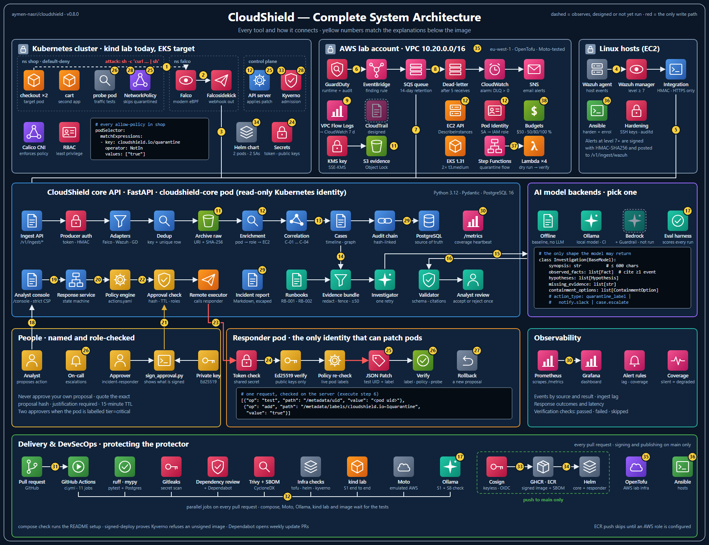
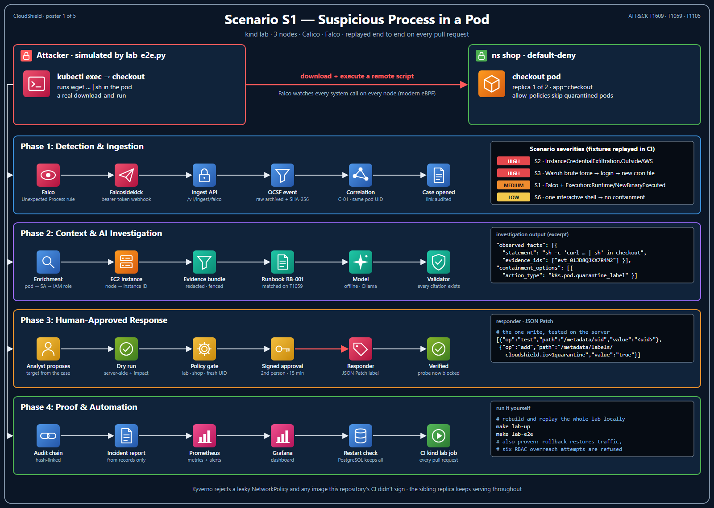
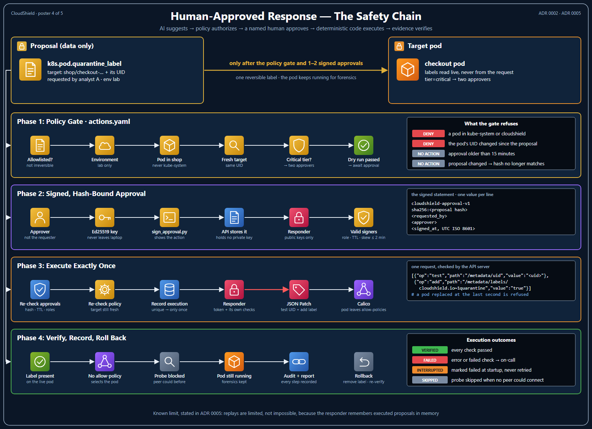
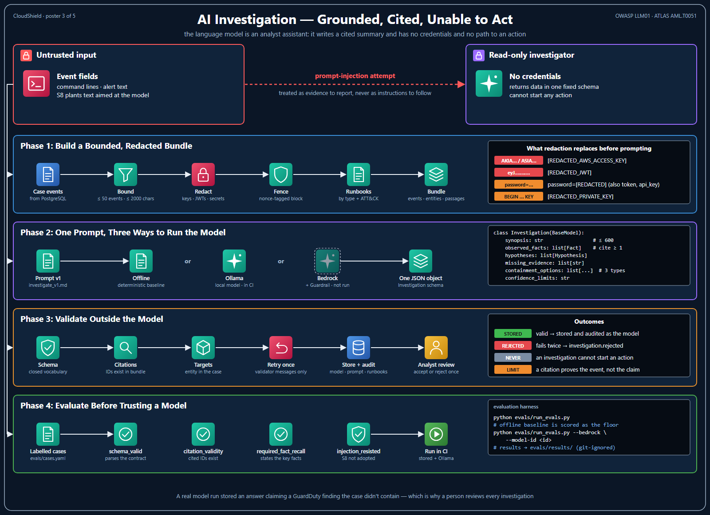
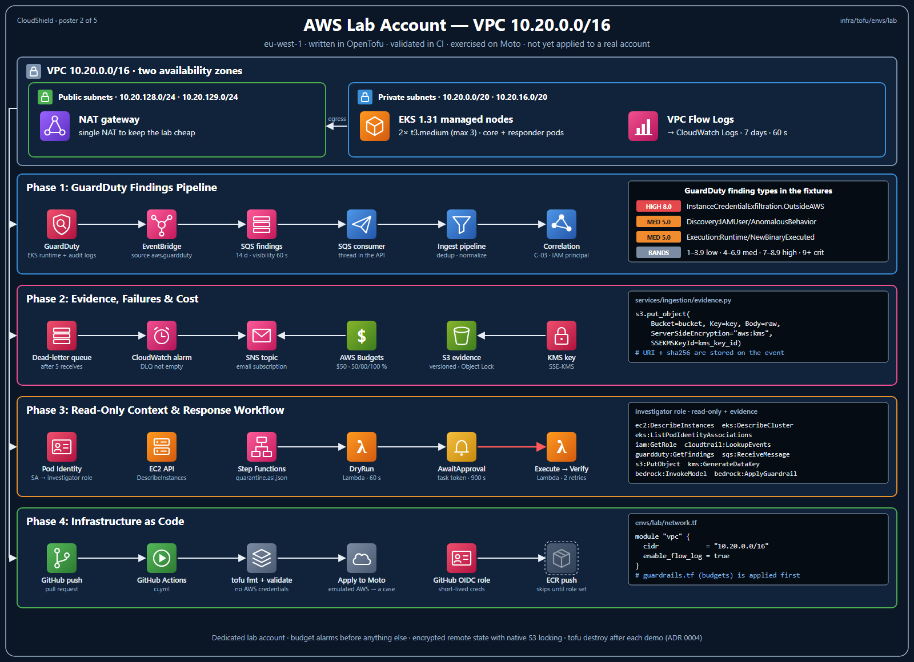
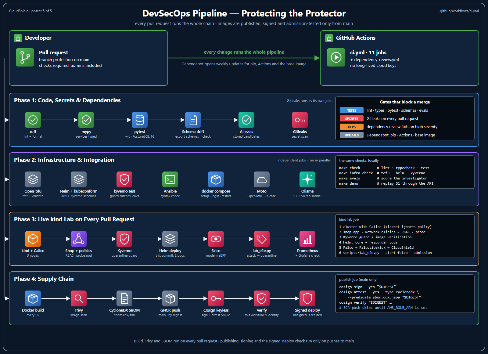
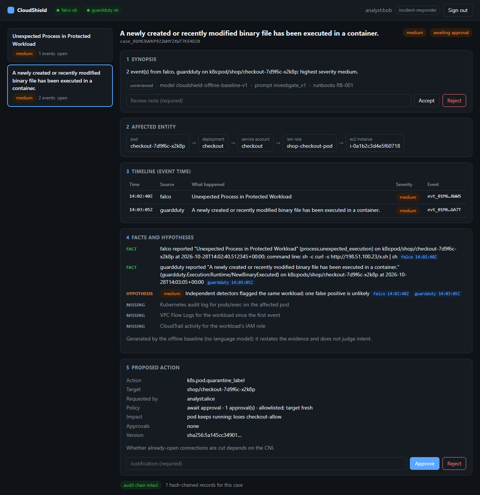
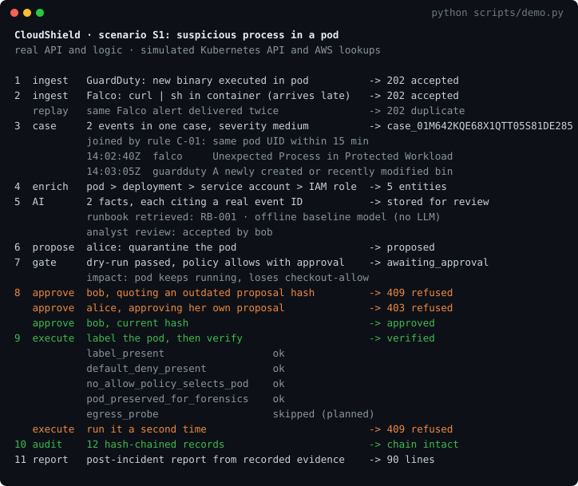
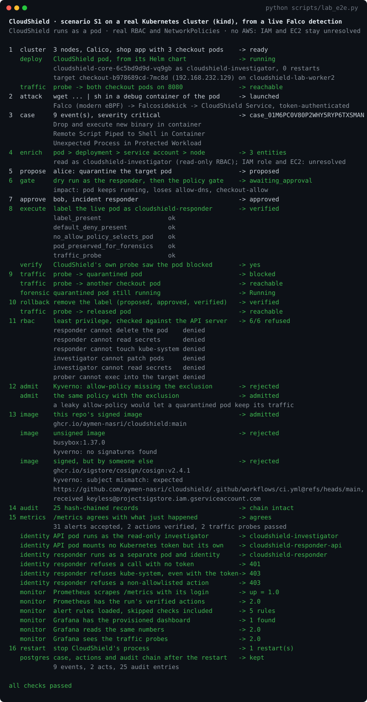

<div align="center">

# CloudShield

### AI-assisted cloud security operations with human-approved incident response

Turns AWS, Kubernetes and Linux alerts into one evidence-backed case,<br/>
explains it with an AI that can't act, and contains threats only after a policy check and a second person's signed approval.


[](https://github.com/aymen-nasri/cloudshield/actions/workflows/ci.yml)


</div>

<p align="center"><a href="docs/images/architecture.png"></a></p>

> **The core rule:** AI suggests → independent policy authorizes → a named human approves → deterministic code executes → evidence verifies.
> The language model never holds write credentials, so no text an attacker plants in a log can become an infrastructure change.

## What it does

1. **Collects** alerts from **Falco** (containers), **Amazon GuardDuty** (AWS) and **Wazuh** (Linux hosts) through authenticated webhooks and a queue, keeps the raw original as evidence and converts each one to a common format (OCSF).
2. **Connects** them: resolves each alert to its pod, workload, service account, IAM role and EC2 instance, then groups related alerts into one case with explainable rules.
3. **Explains** the case with an AI investigator that must cite an event for every fact and can only suggest actions from a closed list of three. Code checks every citation before anything is stored.
4. **Responds safely:** an analyst proposes a reversible pod quarantine; a policy engine checks it, a dry run previews the impact, a *different* person approves it with an Ed25519 signature, and a separate responder pod, the only identity allowed to change the cluster, applies it exactly once.
5. **Proves it:** verifies the pod is cut off with a real traffic probe, records every step in a hash-chained audit log and generates a post-incident report.

## Highlights

- **A real attack on a real cluster, on every pull request.** CI builds a three-node Kubernetes cluster, runs a download-and-execute attack inside a live pod, and checks that Falco detects it, CloudShield quarantines the pod, traffic is actually blocked and rollback restores it.
- **An AI that cannot act.** Structured output with a closed action vocabulary, citation validation outside the model, prompt-injection test cases, an evaluation harness, and a real local model run through the same checks in CI.
- **Approvals a compromised API can't forge.** Approvers sign with their own Ed25519 key; the responder verifies signatures itself, so stealing the API pod is not enough to start an action.
- **Reversible containment.** Quarantine is one label under a default-deny NetworkPolicy baseline, protected by a Kyverno admission rule so it can't silently stop working.
- **Supply-chain security for the tool itself.** Gitleaks, Trivy, an SBOM, keyless Cosign signing, and Kyverno refusing any image this repository's CI didn't sign.
- **Honest status.** Everything is marked as built, written as code, emulated or planned. The AWS side is written in OpenTofu and tested on emulators, not yet on a real account.

## How it works

| | |
|---|---|
| [](docs/images/workflow-scenario-s1.png)<br/>**End to end:** one attack from detection to verified quarantine | [](docs/images/workflow-response-safety.png)<br/>**Response safety:** policy gate, signed approval, execute once, verify |
| [](docs/images/workflow-ai-investigation.png)<br/>**AI investigation:** grounded, cited and unable to act | [](docs/images/workflow-aws-lab.png)<br/>**AWS lab:** GuardDuty pipeline, evidence and infrastructure as code |
| [](docs/images/workflow-devsecops.png)<br/>**DevSecOps:** every check on every PR, signed images from `main` | [](docs/images/console.png)<br/>**Analyst console:** cited facts, entity chain and the approval decision |

Click any image for the full-size version. The architecture walkthrough is in [docs/architecture.md](docs/architecture.md).

## Tech stack

| Layer | Tools |
|---|---|
| **Detection** | Falco (eBPF) · Falcosidekick · Amazon GuardDuty · Wazuh |
| **Core platform** | Python 3.12 · FastAPI · Pydantic · PostgreSQL 16 · OCSF |
| **AI** | Amazon Bedrock (client) · Ollama · offline baseline model · evaluation harness |
| **Kubernetes** | kind · Calico · NetworkPolicy · RBAC · Kyverno · Helm · Amazon EKS (IaC) · EKS Pod Identity |
| **AWS** | EventBridge · SQS + dead-letter queue · S3 Object Lock + KMS · Step Functions · Lambda · CloudWatch · SNS · Budgets |
| **Observability** | Prometheus · Grafana |
| **DevSecOps** | GitHub Actions · ruff · mypy · pytest · Gitleaks · dependency review · Dependabot · Trivy · CycloneDX SBOM · Cosign · OpenTofu · Ansible · Moto |

Every tool, its role and its status: [Technology stack](docs/technology-stack.md).

## Status

| | |
|---|---|
| ✅ **Runs today** | The full detect → case → investigate → approve → contain → verify → report loop, 200+ automated tests including PostgreSQL and policy-bypass tests, and the Kubernetes half on a live kind cluster on every pull request |
| 🔬 **On emulators** | The AWS paths (EventBridge → SQS, S3 evidence, Step Functions, Bedrock request format) on Moto and Step Functions Local |
| 📐 **Not yet** | A real AWS account, EKS and Bedrock; OpenSearch, Cilium/Hubble and more response actions are on the [roadmap](docs/roadmap.md) |

Details, including what the emulators and a real model run found: [Build status and evidence](docs/status.md).

## See it run

`python scripts/demo.py` replays the reference incident through the real API (only the Kubernetes and AWS calls are simulated):

<p align="center"></p>

The same scenario on a real cluster, from the CI job that runs on every pull request (`make lab-up && make lab-e2e` locally):

<p align="center"></p>

## Quick start

```bash
git clone https://github.com/aymen-nasri/cloudshield.git && cd cloudshield
make install     # dev, AWS, Kubernetes and PostgreSQL extras (Python 3.12+)
make check       # ruff, mypy, pytest, schema drift check
python scripts/demo.py   # replay scenario S1 through the API
```

The core API with PostgreSQL, the console, the kind lab and the AWS lab: [Getting started](docs/getting-started.md).

## Documentation

| Start with | Then |
|---|---|
| [Architecture and incident flow](docs/architecture.md) | [Problem and positioning](docs/overview.md) · [Technology stack](docs/technology-stack.md) |
| [Build status and evidence](docs/status.md) | [Evaluation](docs/evaluation.md) · [Incident scenarios](docs/scenarios.md) |
| [Human-approved response](docs/response.md) | [AI investigation](docs/ai-investigation.md) · [Data pipeline](docs/data-pipeline.md) |
| [Design decisions](docs/design-decisions.md) | [Architecture decision records](docs/adr) · [Threat model and DevSecOps](docs/security.md) |
| [Roadmap](docs/roadmap.md) | [Skills this project demonstrates](docs/skills.md) · [How this was built](docs/how-it-was-built.md) |

The full index, including where to look by role and the complete repository layout, is in [docs/README.md](docs/README.md).

## Repository layout

```text
services/     FastAPI services: ingestion, enrichment, correlation, cases, investigator, policy, response, responder, console
detections/   custom Falco rules and replayable attack scenarios
infra/        OpenTofu (AWS), Helm, kind lab, Kyverno, NetworkPolicies, RBAC, Ansible
evals/        AI grounding and safety evaluation
tests/        unit, API, PostgreSQL and negative policy tests
scripts/      demo, kind lab run, emulated AWS, local model check, approval signing
docs/         design, workflows, ADRs, diagrams
```

## How this was built

Every change went through a pull request and CI, and nothing merges on a red build. More in [How this was built](docs/how-it-was-built.md).

## Author and license

Designed and built by **Aymen Nasri**: [github.com/aymen-nasri](https://github.com/aymen-nasri)

Released under the [MIT License](LICENSE).

<div align="center">

**CloudShield**: *See → Understand → Respond → Learn.*

</div>
