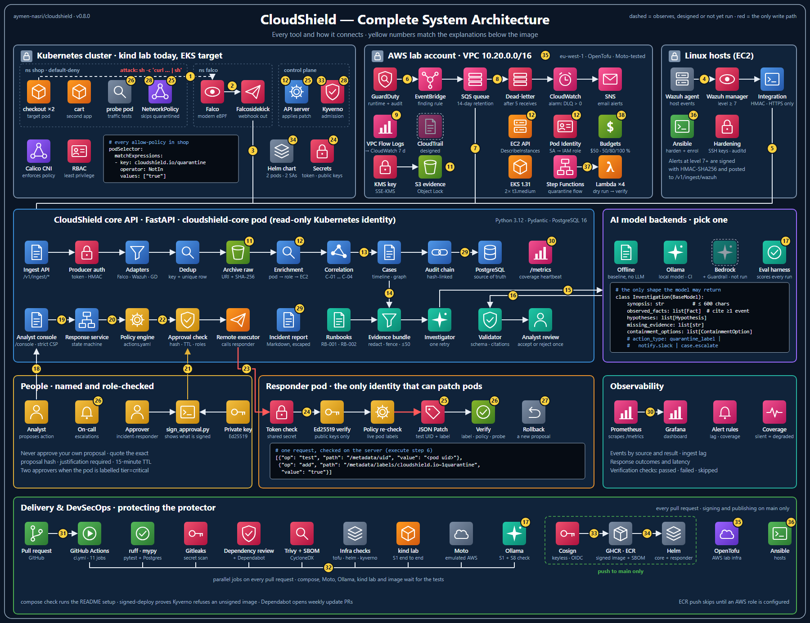
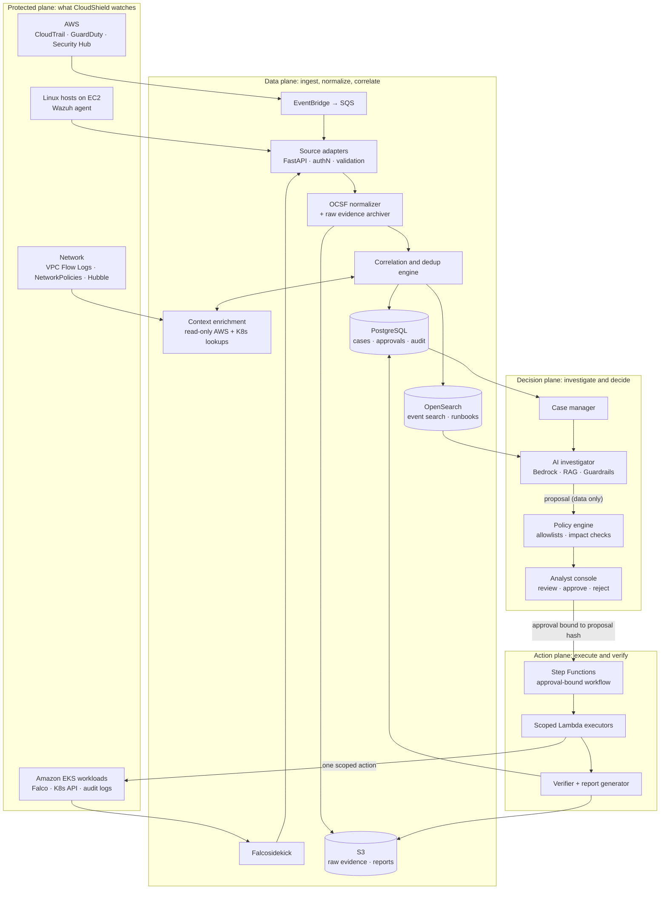
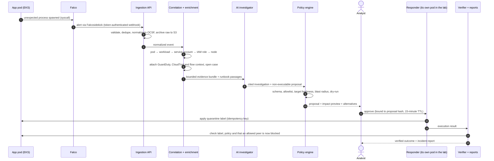

# Architecture and incident flow

What CloudShield is, how its five planes fit together, and how one incident moves through them. Part of the [CloudShield documentation](../README.md#documentation).

Status markers: ✅ built and tested · 🧩 written as code, not deployed · 📐 designed only · 🔬 run on an emulator or a stand-in, not on real AWS.

## What CloudShield is

CloudShield is a unified, AI-assisted security operations platform for teams running on **AWS and Kubernetes**. It connects AWS cloud findings, Linux host activity, Kubernetes workload behavior and network telemetry into **one evidence-backed incident case**. It then helps an analyst understand what happened, choose a safe response and prove the outcome.

It works in four stages:

| Stage | What CloudShield does | What it produces |
|---|---|---|
| **SEE** | Receives security signals from cloud, hosts, clusters and networks | Structured alerts, each linked to its raw source record |
| **UNDERSTAND** | Correlates related events and enriches them with asset, identity and service context | An evidence-backed incident case |
| **RESPOND** | Proposes containment, previews consequences, gets approval and performs only authorized steps | A verified action record |
| **LEARN** | Generates timelines, post-incident reports and proposed rule and runbook improvements | Reusable investigation knowledge |

### What makes it different

CloudShield does **not** reinvent detection, a SIEM, or AWS's own AI investigations (GuardDuty announced AI-powered investigations in preview in June 2026 [[R1]](references.md#references)). It adds the three things those tools leave open:

1. **Cross-layer context.** One case links the AWS identity, the EC2 node, the Kubernetes pod, its service account and the network paths it uses.
2. **Explainable investigations with provenance.** Every factual claim the AI makes cites the exact event IDs behind it. Facts, hypotheses and unknowns are kept apart.
3. **Response safety.** A deterministic policy gate, impact preview, named approval, idempotent execution and post-action verification stop an automated mistake from becoming an outage.

### Scope

| In scope | Explicitly out of scope |
|---|---|
| Monitoring integrations, case assembly, read-only enrichment | Replacing GuardDuty, Wazuh, Falco or the AWS security stack |
| Analyst dashboard and LLM-assisted explanation | Running as a managed SOC service |
| Policy- and approval-gated response with verification | Irreversible actions (deleting resources, destroying keys, erasing data) |
| Reports, audit trail and a secure CI/CD pipeline | Any execution path from the LLM to production |

**Guiding principle:** prove one complete incident workflow end to end before adding more infrastructure or tools.

## Architecture

CloudShield separates **collection**, **evidence processing**, **AI assistance**, **human decisions** and **execution** into distinct planes. These boundaries are what make the system explainable, safe and independently scalable.

> **Target architecture.** ✅ Built: ingestion, enrichment, correlation, cases, AI investigator, policy engine, console, executor, verifier, reports, PostgreSQL. 🧩 As code: EventBridge → SQS, the S3 evidence bucket, the Step Functions + Lambda execution path. 📐 Designed: OpenSearch, Security Hub, Hubble, a configured Bedrock Guardrail.

### The five planes

| Plane | Responsibility | Key components |
|---|---|---|
| **Protected** | The AWS resources, Linux systems, Kubernetes workloads and networks being observed | VPC, EC2, EKS, IAM |
| **Data** | Ingestion, schema normalization, indexing, evidence storage, enrichment and correlation | FastAPI, OCSF, PostgreSQL, OpenSearch, S3 |
| **Decision** | Case management, investigator UI, LLM/RAG assistant, risk and policy evaluation, approvals | Bedrock, RAG, policy engine, console |
| **Action** | Restricted execution, outcome checks, audit records and rollback guidance | Step Functions, Lambda, scoped IAM/RBAC |
| **Delivery / operations** | IaC, CI/CD, images, configuration, observability and the security controls that protect CloudShield itself | OpenTofu, GitHub Actions, ECR, Kyverno, Prometheus |

## End-to-end incident flow

**Reference scenario:** an application pod on Amazon EKS shows suspicious in-container process activity. The activity is simulated and confined to an isolated lab. CloudShield investigates the evidence and carries out an authorized, verifiable response.

| Step | Stage | What happens |
|---|---|---|
| 1 | **Workload** | An application pod runs in an AWS-hosted Kubernetes cluster |
| 2 | **Detect** | Falco raises a runtime alert about an unexpected process |
| 3 | **Ingest** | The adapter authenticates, validates, deduplicates and normalizes the event, and archives the raw payload |
| 4 | **Enrich** | The pod is resolved to its workload, service account, IAM role, node and recent network context |
| 5 | **Investigate** | The LLM summarizes the evidence, separates facts from hypotheses and cites event IDs |
| 6 | **Recommend** | The policy layer prepares a scoped containment proposal with an impact check and dry-run |
| 7 | **Approve** | An analyst reviews evidence, consequences and alternatives, then approves or rejects |
| 8 | **Verify** | The executor acts exactly once; the verifier checks the result; the report is generated |

### What the demonstration proves

- Detection carries the **correct pod and runtime context**, not just an alert string.
- Correlation links evidence by **explicit identifiers and time ranges** without merging unrelated events.
- The AI **separates facts from suspicions** and references exact event records.
- An **unsafe suggestion cannot pass** the policy gate.
- The approved action is **reversible, runs exactly once** and has a verified result.
- The final report reconstructs **who decided, why, what changed and what is still unknown**.
